 

 

[About](#about) &nbsp;·&nbsp; [How I build](#how-i-build) &nbsp;·&nbsp; [Learning path](#learning-path) &nbsp;·&nbsp; [Tech stack](#tech-stack) &nbsp;·&nbsp; [CodeMini IDE](#codemini-ide) &nbsp;·&nbsp; [Stats](#github-stats) &nbsp;·&nbsp; [Connect](#lets-connect)

## About

 

I'm **Chris**, a **vibe coder**. I build web apps by describing what I want, working with AI as my pair programmer, and iterating until it feels right. No bootcamp, no classroom, just curiosity, late nights, and a lot of "why isn't this centered?" moments.

I started with **HTML and CSS**, got hooked on bringing pages to life with **JavaScript**, and now I use AI to move faster while learning **React** and understanding the code I ship.

| 🧠 Right now | 🎨 What I enjoy | 🤝 Open to |
|:---:|:---:|:---:|
| Learning React components, props, state and hooks, not just generating them | Clean layouts, smooth interactions and responsive design | Collaborations, code reviews and open-source contributions |

 

### What vibe coding means to me

| | |
|:--|:--|
| 💬 **I steer.** I describe the vision, AI helps write the code, and I guide the result. | 🔍 **I read everything.** I test and tweak what gets generated, so I actually learn from it. |
| 🐛 **I debug and take notes.** When something breaks, I fix it with AI and write down what went wrong. | 🚀 **I ship.** Real things out in the world matter more to me than writing every line by hand. |

## How I build

| Idea | Prompt | Generate | Review | Ship |
|:---:|:---:|:---:|:---:|:---:|
| What should exist? | Describe the vision | AI drafts the code | Read, test, learn | Deploy and share |

## Learning path

HTML, CSS and JavaScript are done. React is the current focus. Next.js and TypeScript come after.

## Tech stack

<b>Core</b> 

  

<b>Learning now</b> 

  

<b>Up next</b> 

  

<b>Tools</b> 

  

## CodeMini IDE

No PC? No problem. I built **CodeMini IDE** with AI as my coding partner: a code editor that runs right in the browser and works on mobile, so I can code from anywhere.

 

<table>
  <tr>
    <td align="center"><b>📁 File explorer</b> files, folders and workspaces</td>
    <td align="center"><b>🔍 Search and replace</b> across the whole project</td>
    <td align="center"><b>▶️ Run and console</b> output right in the browser</td>
  </tr>
  <tr>
    <td align="center"><b>👁️ Live preview</b> see your page as you type</td>
    <td align="center"><b>🌿 Source control</b> track every change</td>
    <td align="center"><b>🚀 One-click deploy</b> from editor to live</td>
  </tr>
  <tr>
    <td align="center"><b>🤝 Live collaboration</b> code together</td>
    <td align="center"><b>🎨 SVG editor</b> draw and edit vectors</td>
    <td align="center"><b>🧘 Zen mode</b> distraction-free coding</td>
  </tr>
  <tr>
    <td align="center"><b>💻 Terminal</b> built in</td>
    <td align="center"><b>📱 Mobile friendly</b> code from your phone</td>
    <td align="center"><b>✨ And much more</b> new features keep landing</td>
  </tr>
</table>

 

## GitHub stats

 

 

 

  

<picture>
  <source media="(prefers-color-scheme: dark)" srcset="https://raw.githubusercontent.com/CoderCriss/CoderCriss/output/github-snake-dark.svg" />
  <source media="(prefers-color-scheme: light)" srcset="https://raw.githubusercontent.com/CoderCriss/CoderCriss/output/github-snake.svg" />
  
</picture>

## Let's connect

I'm open to **collaborations**, **code reviews** and **open-source contributions**. If you're building something and want another pair of eyes (or hands), say hi.

<!--
Add your own links here, for example:

-->

 

